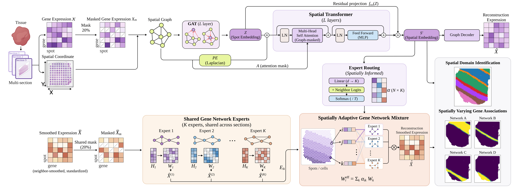
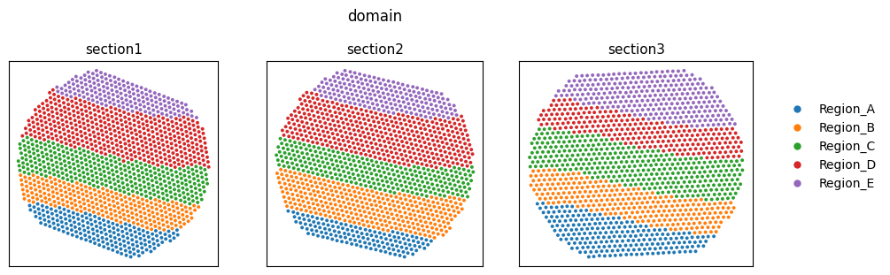
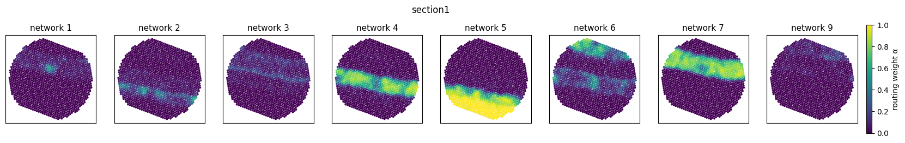
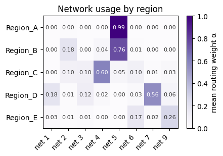
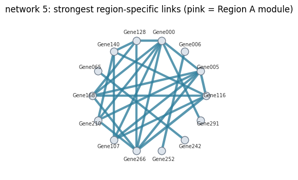

<div align="center">

# 🥭 MANGOST

### **M**ixture of **A**daptive **N**etworks for **G**ene-association **M**odeling in **S**patial **T**ranscriptomics

*Spatially adaptive mixtures of shared gene association networks for multi-section spatial transcriptomics*

[](https://www.python.org/)
[](https://pytorch.org/)
[](LICENSE)
[](tutorials/MANGOST_tutorial.ipynb)

</div>

---

## 🥭 What is MANGOST?

Spatial representation learning identifies tissue domains, but leaves open **how genes relate to one another within
and across those domains**. MANGOST is a spatially adaptive mixture-of-networks framework that learns spatial
representations and gene association networks jointly across multiple tissue sections, from expression alone and
without annotations:

1. a **spatial embedding** `s'` of every spot, clustered into **spatial domains**;
2. a collection of **gene association networks** `W_1 ... W_K` shared across all sections, capturing recurring gene
   relationships;
3. a **spatially informed routing weight** `alpha` that assigns each spot its own mixture of networks, so the shared
   networks can be used differently across tissue locations and similarly by neighbouring spots.

The encoder, networks and router are optimised together through expression reconstruction and masked gene
prediction, so gene association modelling also contributes to the spatial representation. Across four spatial
transcriptomics datasets (10x Visium DLPFC, Spatial Transcriptomics mouse brain, MERFISH and STARmap PLUS), MANGOST
gives competitive spatial domains, and its networks show spatially distinct usage associated with tissue
organisation.

<p align="center">
  
</p>

**How it works**

| step | module |
|---|---|
| 🧬 encode | a **masked graph-attention encoder** reads each spot's expression (20% of entries masked) and its spatial neighbours |
| 🗺️ contextualise | a **spatial transformer** with Laplacian positional encoding and graph-masked attention gives the spatial embedding `s'`; a graph decoder reconstructs the expression from `s'` |
| 🔀 route | a **spatially informed router** (linear map of `s'` plus neighbour logits, softmax) gives `alpha` (spots x K) |
| 🕸️ explain | **K shared low-rank gene networks** `W_k = offdiag(G_k G_kᵀ / d)` predict each spot's neighbour-smoothed expression; a likelihood mixture trains each network on the spots it explains best, and a gate term teaches the router which network that is |
| 🧩 read out | per-section clustering of `s'` → **domains**; region means of `alpha` → **where each network is used**; `W_k − mean(W)` → **region-specific gene links** and hub genes |

All sections of a dataset are trained **jointly**, so the networks are learned from every section at once.

---

## 📦 Installation

```bash
git clone https://github.com/Myeongbin-Oh/MANGOST.git
cd MANGOST
pip install -e .                 # add [tutorial] for Jupyter: pip install -e ".[tutorial]"
```

Requirements: Python ≥ 3.9, PyTorch ≥ 2.0, PyTorch Geometric, scanpy / anndata.
For clustering exactly as in the paper, install **R** with the `mclust` package
(`install.packages("mclust")`); otherwise use the Python fallback `method="gmm"`.

---

## 🚀 Quick start

```python
import anndata as ad
import mangost as mg

adata = ad.read_h5ad("data/mangost_synthetic.h5ad")      # raw counts, obs["section"], obsm["spatial"]

model = mg.MANGOST(K=10, epochs=600, seed=0)
model.fit(adata, section_key="section", n_hvg=None, radius=1.5)

mg.tl.cluster_domains(adata, groupby="region")           # per-section mclust on s'  -> obs["mangost_domain"]
mg.tl.score(adata, "mangost_domain", "region")           # ARI / NMI per section

usage = mg.tl.region_usage(adata, groupby="region")      # mean routing weight of each network per region
model.hub_genes(k=5, n=15)                               # genes driving network 5's region-specific links
model.top_edges(k=5, n=30)                               # its strongest region-specific gene pairs
```

From the command line:

```bash
python scripts/run_mangost.py data/mangost_synthetic.h5ad --label region --n-hvg 0 --out results/
```

---

## 📓 Tutorial

👉 **[tutorials/MANGOST_tutorial.ipynb](tutorials/MANGOST_tutorial.ipynb)**: a complete run on the bundled synthetic
dataset, with all outputs (about 5 minutes on a CPU).

The synthetic tissue (`data/mangost_synthetic.h5ad`, made by `mg.datasets.make_synthetic()`) has 3 sections, about
4,100 spots, 300 genes and 5 laminar regions. Every region has its own marker genes **and its own gene co-expression
module** (15 genes that co-vary only inside that region), so both outputs of MANGOST can be checked against the truth.

| | |
|:---:|:---:|
| **Annotation** | **MANGOST domains** (mean ARI 0.97, NMI 0.96) |
|  |  |

**Where each gene network is used** (section 1): different layers switch on different networks.



| Network usage by region | Strongest links of the Region A network (pink = planted Region A module) |
|:---:|:---:|
|  |  |

The hub genes of the networks recover the planted region modules well above chance (up to 6 of the top 15 hub genes,
against fewer than one expected by chance).

---

## 🧰 Input format

One `AnnData` with all sections stacked:

| field | content |
|---|---|
| `X` or `layers[counts_layer]` | raw counts, spots x genes |
| `obs[section_key]` | section id of every spot |
| `obsm["spatial"]` | spot coordinates (any unit; graph distances are in units of the spot pitch) |
| `obs[...]` | *optional* annotation, used only to choose `k` and to score |

Outputs: `obsm["X_mangost"]` (spatial embedding `s'`), `obsm["mangost_alpha"]` (routing weights),
`uns["mangost"]` (network genes, networks in use, settings).

---

## ⚙️ Settings used in the paper

One graph rule for every dataset, with dataset-specific values: neighbours within `radius` x spot pitch, optional
expression pruning, and optional input smoothing over `hops` steps of the graph.

| dataset | platform | genes | `radius` | pruning | `hops` |
|---|---|---|---|---|---|
| DLPFC | 10x Visium | 4,000 HVG | 1.5 | `cut=0.75`* | 0 |
| Ortiz ST | Spatial Transcriptomics | 4,000 HVG | 1.5 | `cut_quantile=0.4` | 0 |
| MERFISH | MERFISH (preoptic) | 155 (panel) | 3.0 | none | 6 |
| STARmap PLUS | STARmap PLUS, 48.5 µm bins | 1,022 (panel) | 1.5 | `cut_quantile=0.4` | 0 |

Model and training (defaults of `mg.MANGOST`): `K=10`, gene-embedding rank 64, encoder width 512, transformer
width 128, 30-dim embedding, 20% masking, likelihood-mixture temperature 0.1, gate weight 0.1, minimum usage 1/(4K),
AdamW (lr 1e-3, weight decay 1e-2), 5 warm-up epochs then cosine decay, 600 epochs, one step per section per epoch,
deterministic kernels.

<details>
<summary>Implementation notes for exact reproduction</summary>

* The model code is taken from the implementation used for the paper, keeping only the final configuration;
  parameters are created in the same order, so a given seed gives the same initialisation.
* \*The DLPFC graph in the paper was precomputed with an equivalent rule on each section's own 4,000 HVGs
  (cosine threshold on the rescaled similarity); `mangost.graph` applies the general rule used for the other datasets.
* The degree floor of the expression pruning counts directed edges, as in the paper's code: every spot keeps at least
  one neighbour.
* With `hops > 0`, the smoothed expression is also the source of the network target and of the network-gene selection.
* The spatial transformer computes dense N x N attention masks per section, so memory grows with the square of the
  number of spots per section.

</details>

---

## 🗂️ Repository

```
MANGOST/
├── mangost/
│   ├── model.py        # encoder, spatial transformer, router, gene-network bank
│   ├── losses.py       # reconstruction, likelihood mixture, gate, smoothness, usage floor
│   ├── graph.py        # radius graph, expression pruning, Laplacian PE, input smoothing
│   ├── trainer.py      # MANGOST class: preprocessing, joint training, read-outs, save / load
│   ├── tools.py        # domains (mclust / GMM), scores, region usage, regional sets
│   ├── plotting.py     # spatial maps, routing maps, usage heat map, network graphs
│   └── datasets.py     # synthetic multi-section data
├── tutorials/MANGOST_tutorial.ipynb
├── scripts/run_mangost.py
├── data/mangost_synthetic.h5ad
├── assets/             # README figures
└── tests/
```

---

## 📖 Citation

If you use MANGOST, please cite:

> Myeongbin Oh and Minsik Oh. **MANGOST: Spatially Adaptive Mixtures of Shared Gene Association Networks for
> Multi-Section Spatial Transcriptomics.** (manuscript in submission; the full reference will be added here)

## 📝 License

MANGOST is released under the [PolyForm Noncommercial License 1.0.0](LICENSE): free for academic research and other
non-commercial use. Commercial use requires a separate license; please contact the author.

Copyright (c) 2026 Myeongbin Oh.

<div align="center">

Made with 🥭 for spatial transcriptomics.

</div>
